# Emerald Valley Station (翠谷站)

Procedural Blender model of a futuristic green rail hub: undulating gridshell roof on
branching "dendriform" columns, a forest valley with a stream between two elevated
maglev decks, a canopy walk, vine curtains, roof gardens, solar glazing and a reflecting pool.

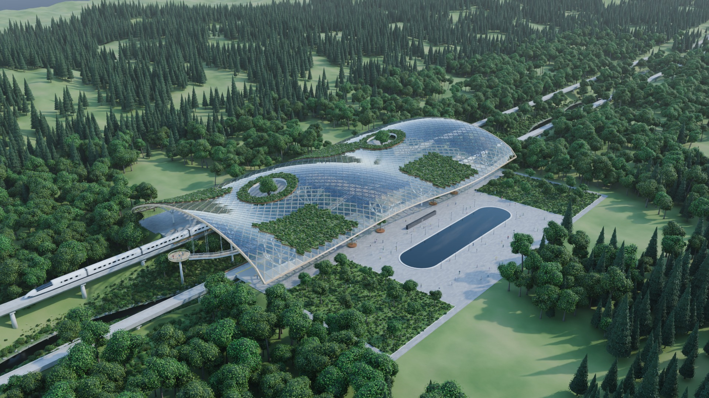

## Status
- `build_station.py` builds `station.blend` from scratch (~10 s, no external assets).
- `render.py` renders any camera in day or dusk light with Cycles; stills and the
  fly-through are in [`renders/`](renders/).
- `web/index.html` is a self-contained showcase: the renders, the fly-through video,
  path-traced 360° photos and a real-time first-person walk/fly through the model.
- Targets **Blender 5.2 LTS** (Cycles path tracing, OpenImageDenoise, geometry-nodes
  scattering, multiple-scattering sky, AgX colour).

## What's in the scene
| Element | How it's made |
|---|---|
| Gridshell roof | 216 m x 106 m diagrid of glulam members over an undulating (u, v) surface; clear glazing, semi-transparent PV glazing (opaque cells, clear gaps), corten roof-garden trays, two oculi with planted collars |
| Dendriform columns | 4 valley columns + 12 plaza/terrace columns; trunk -> 4 branches -> 8 tips that land on the roof |
| Valley | 3 km x 2.2 km terrain with a meandering stream, gravel trail, rocks, and geometry-nodes forest / conifer / grove / understory scatters (all instanced) |
| Maglev decks | Two U-channel guideways on piers, platforms with terrazzo floors, benches, displays, LED coves; a sky bridge with escalators |
| Canopy walk | Two timber walkways hung from the roof, a spiral stair tower to the trail and a cantilevered lookout |
| Vine curtains | ~1,500 hanging strands (~70k leaves) from the guideway planters and the roof eaves |
| Plaza | Stadium-shaped reflecting pool, lawns with trees, lamp posts, 翠谷站 sign |
| Trains | Two 6-car maglev sets: one passes through at speed, one brakes into the south platform |
| People | ~200 simple figures on the plaza, platforms, bridge, walks and trail |

## Setup
Either the Blender 5.2 LTS app from <https://www.blender.org/download/>, or Blender as a
Python module (no GUI needed; Python 3.13):
```
python3.13 -m venv blender52
blender52/bin/pip install bpy==5.2.3
```

## Build
```
blender -b --factory-startup --python build_station.py
# or
blender52/bin/python build_station.py
```

## Render
```
blender -b station.blend --python render.py -- --cam CAM_Aerial --mode day --res 960 540 --samples 16 --out renders/{cam}_{mode}.png
# or
blender52/bin/python render.py --cam all --mode both --res 1920 1080 --samples 48
```
Cameras: CAM_Aerial, CAM_Plaza, CAM_Valley, CAM_Platform, CAM_Roof, CAM_TrailUp, CAM_Fly (or `all`).
Modes: day, dusk (or `both`). `--anim` renders frames 1-240 to MP4 (trains move, CAM_Fly flies
the valley); frames are written to `renders/<name>_frames/` first, so an interrupted run resumes.
Other options: `--frame N`, `--frames A B`, `--sun-az/--sun-el` (compass degrees),
`--no-motion-blur`, `--threads N`.

`--pano` renders 360° equirectangular panoramas (3072x1536) at the eight `PANO_*` spots
(plaza, platform, sky bridge, canopy walk, stream trail, stair tower, lookout, roof) into the
path given by `--out`, e.g. `--pano --mode both --samples 32 --out web/pano/{cam}_{mode}.jpg`.

Rendering uses Cycles on the CPU with OpenImageDenoise, so it works headless without a GPU.
`--engine EEVEE` is available but needs a GPU/display.

## Gallery
1920x1080, Cycles 40 samples + OpenImageDenoise, ~3-7 min per frame on 4 CPU cores.

| Day | Dusk |
|---|---|
|  | 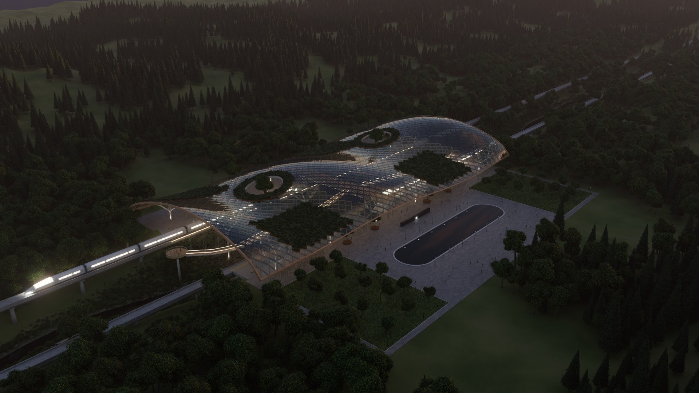 |
| 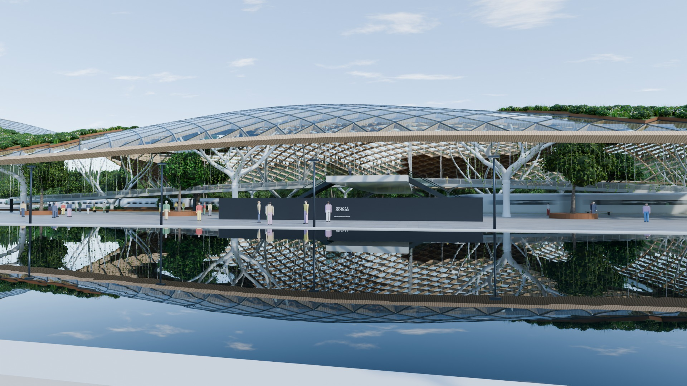 | 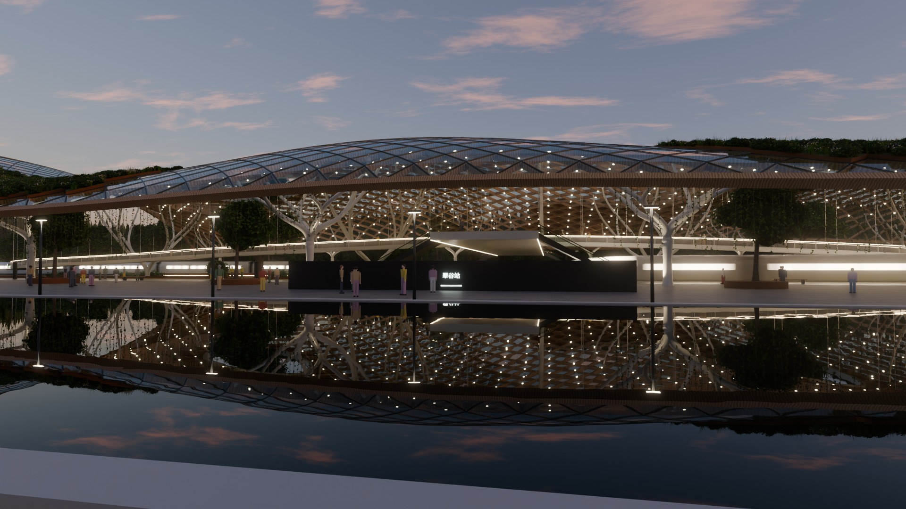 |
| 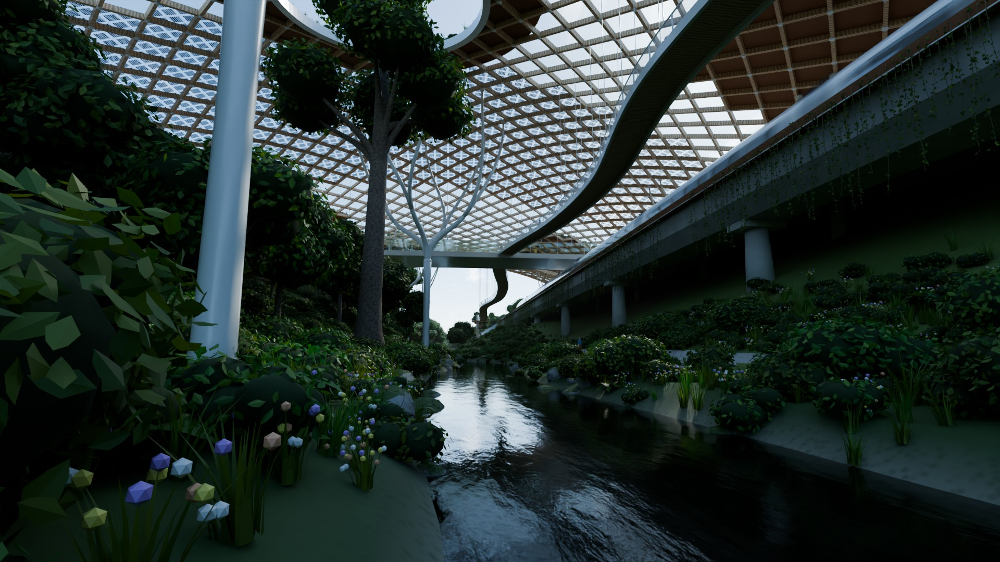 | 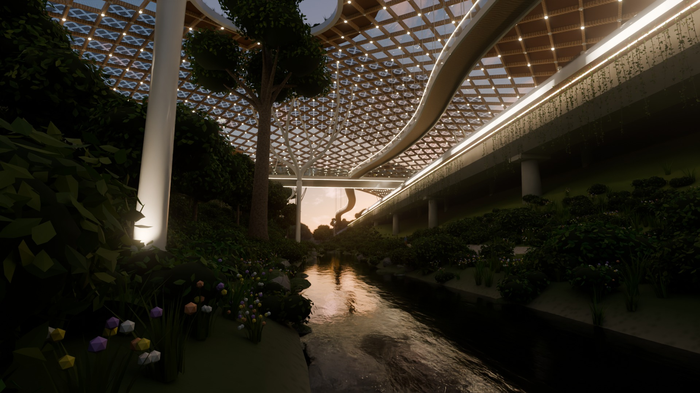 |
| 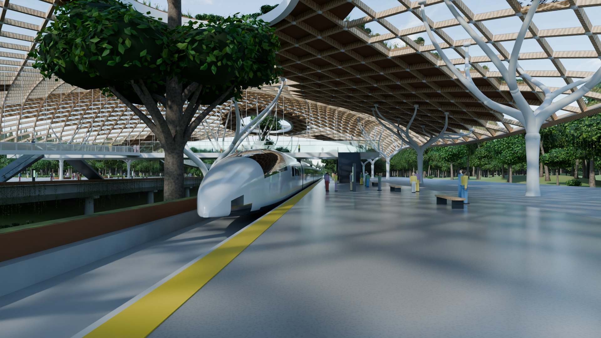 | 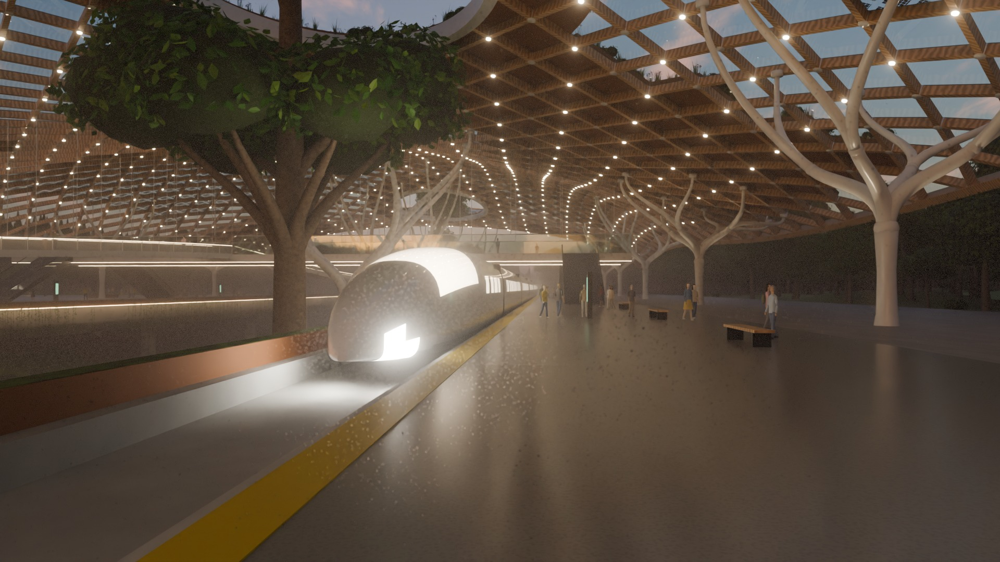 |
| 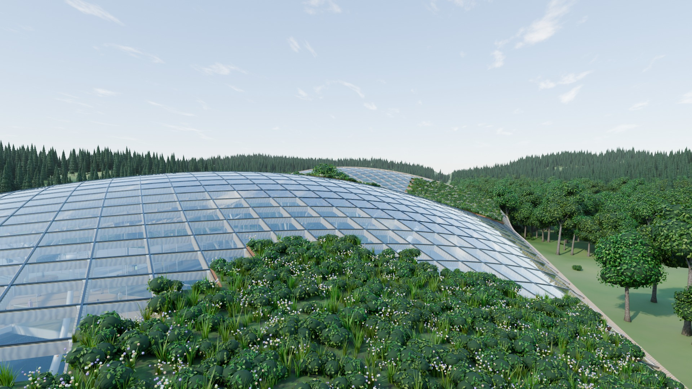 | 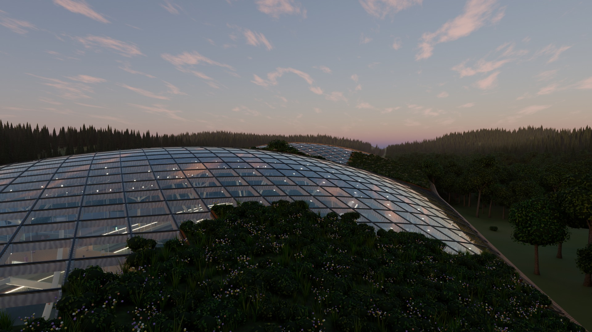 |
| 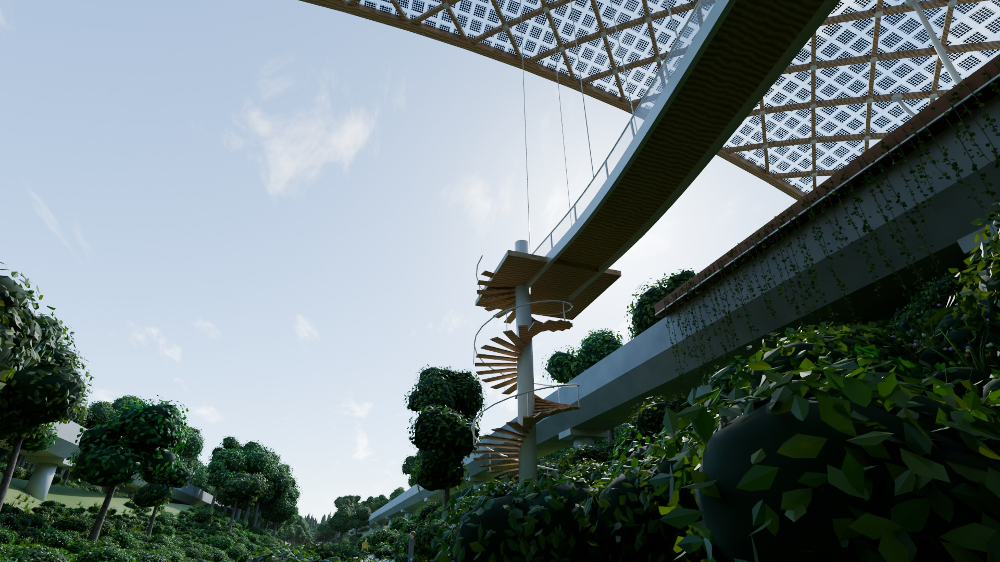 | 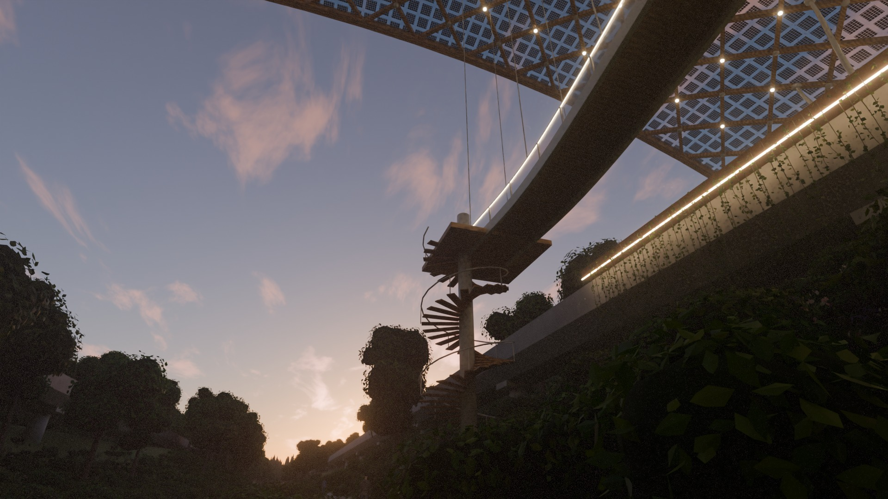 |
| 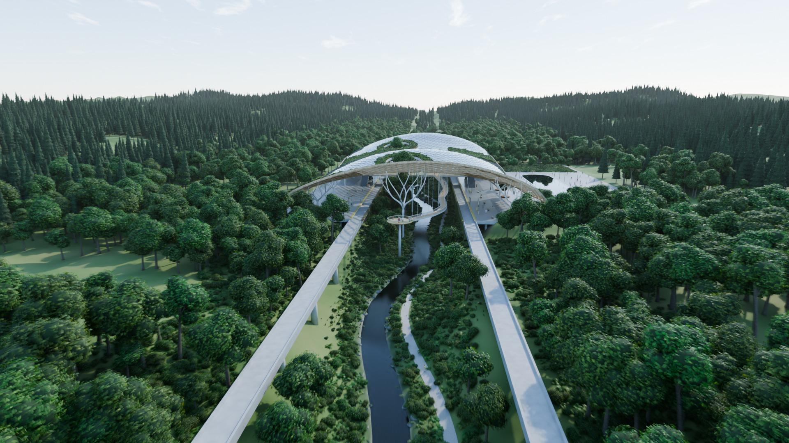 | 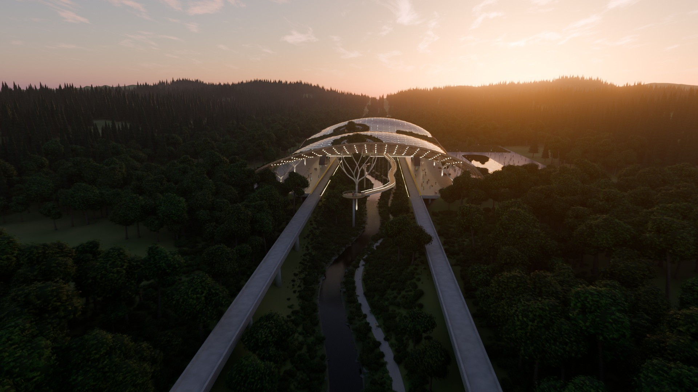 |

## Web viewer
```
blender52/bin/python render_sprites.py     # Cycles impostors of the plants -> web/trees.png
blender52/bin/python export_web.py         # station.blend -> web/station.json + web/*.bin (~15 MB gzip)
python3 -m http.server 8000                # then open http://localhost:8000/web/
```
The page opens on a gallery of the Cycles renders, the video and the 360° photos (no 3D
download needed). **Walk through in 3D** loads the model into the browser (three.js, WebGL 2):
- **Walk** with collision and gravity, or **Fly**; mouse/keyboard on laptops, touch stick on phones.
- **Ride the express** on the nose of the maglev, or sit back for the **cinematic tour**.
- Glass control dock: walk/fly, a time-of-day slider from 14:30 through dusk to a starry night, **Places** (glide to
  viewpoints or open 360° photos), a live mini-map (click to glide there), detail settings,
  ambient sound (stream, wind, birds, crickets, passing trains; synthesised, no audio files).
- Fourteen discoveries to find; birds, butterflies, fireflies at dusk, sun shafts with drifting
  dust through the oculi, drifting clouds and their shadows, swaying vegetation, rippling water.
- Real-time realism: plants near you are the very meshes the Cycles renders use, far trees are
  Cycles-rendered impostors, and ambient occlusion and forest-floor shade are baked from the model.
- Detail adapts to the device: strong machines climb to Ultra (4K shadows, ambient occlusion,
  full-resolution mirror pool), weaker ones briefly lower render resolution to stay smooth.
  The renders, video and 360° photos are full quality everywhere.

## Photoreal tour
`tour/index.html` is a 360° photo tour in which every view is a path-traced Cycles render (6144x3072, day
light, no people) at one of 44 spots along the plaza, concourse, sky bridge, canopy walk, valley trail,
platforms, gardens and roof. Moving between spots glides through the scene: each panorama is wrapped on its
own rendered depth map, so near things slide past far ones as in a real walk.
```
blender52/bin/python render_tour.py --pass depth --resume      # depth maps, about a minute each
blender52/bin/python render_tour.py --pass color --resume      # panoramas, in the order of tour/spots.json
python3 -m http.server 8000                                     # then open http://localhost:8000/tour/
```
- Drag to look, click a ring (or the ground) to walk there, or <kbd>W</kbd>/<kbd>S</kbd> to step forward and back.
- Places along the bottom and the map glide along the routes; <kbd>P</kbd> starts a guided tour.
- The viewer only offers spots listed in `tour/ready.json` (written by `tour_assets.py` as each panorama
  finishes), so it is walkable while the rest are still rendering.
- Phones load 3072-pixel panoramas; laptops and desktops the full 6144 ones, fetched in the background.

## Files
- `build_station.py` - the procedural model (geometry, materials, scatters, trains, cameras, world, compositor)
- `station_modes.py` - day/dusk lighting presets, shared by the build and render scripts
- `render.py` - command-line renderer
- `render_sprites.py` - renders the far-tree impostor atlas (`web/trees.png`) with Cycles
- `export_web.py` - exports the scene for the web viewer (quantized, gzip-compressed binary meshes and instances)
- `render_tour.py` - renders the tour's panoramas and depth maps; `tour_assets.py` makes their web sizes
- `tour/` - the photoreal tour viewer, its spots and routes (`spots.json`), panoramas and depth maps
- `web/` - the showcase page, exported model and 360° photos (`web/pano/`)
- `renders/` - finished stills (`<camera>_<mode>.jpg`) and the fly-through
